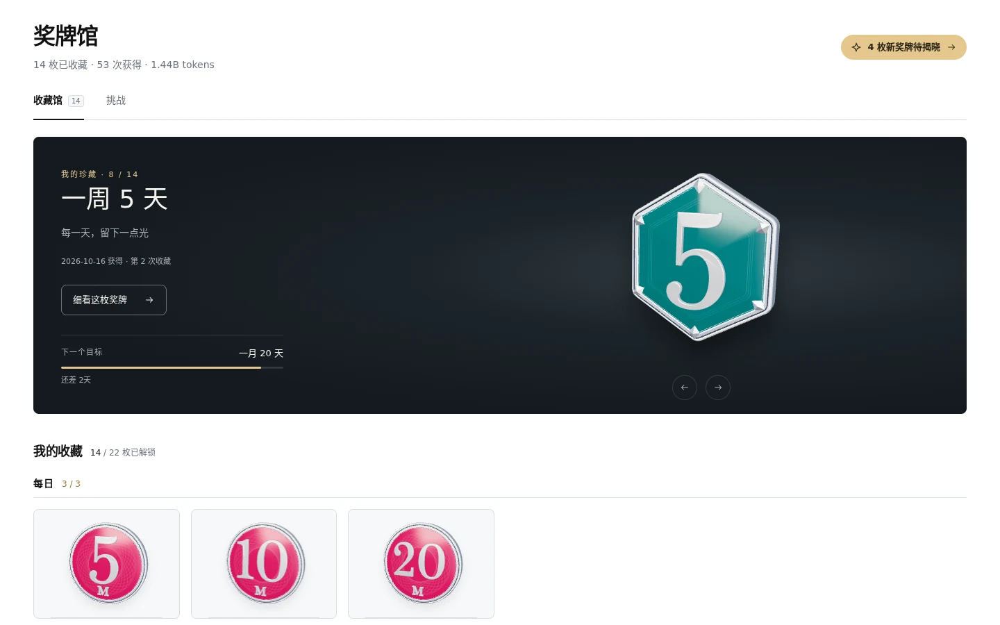
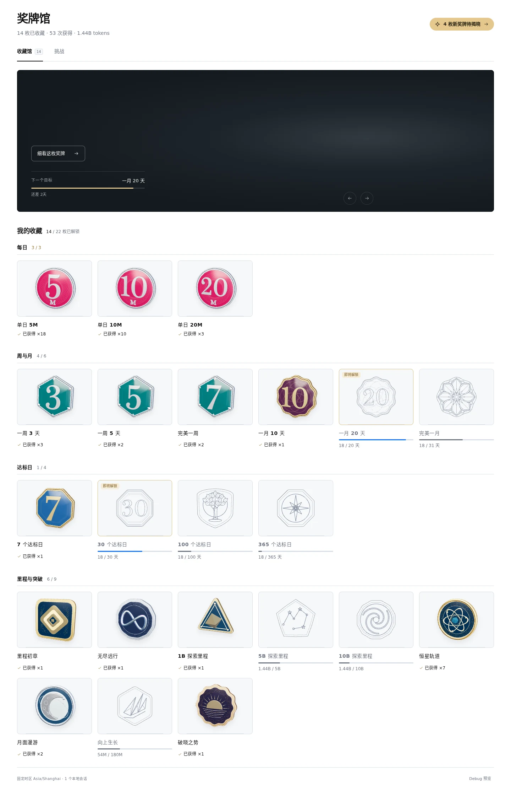
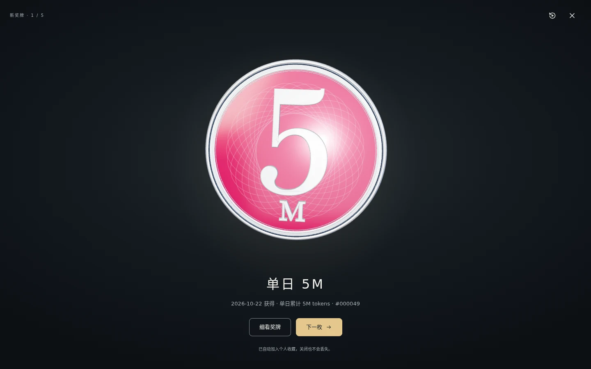
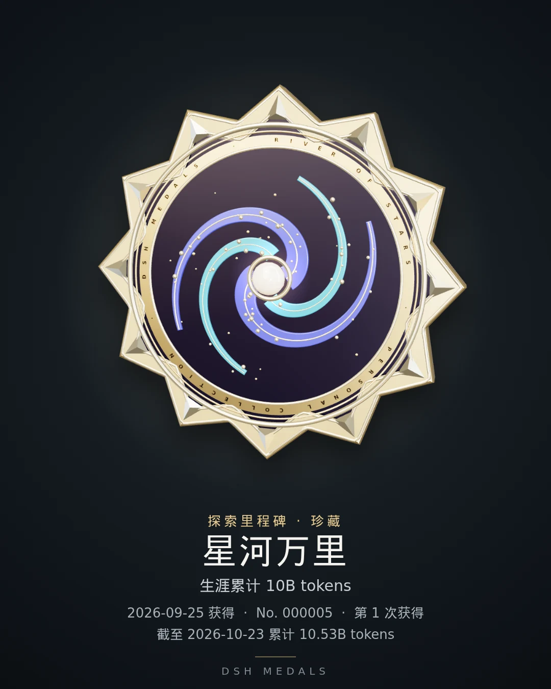
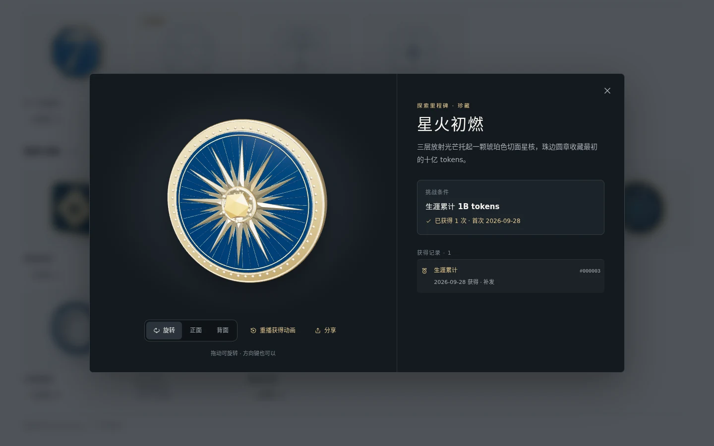
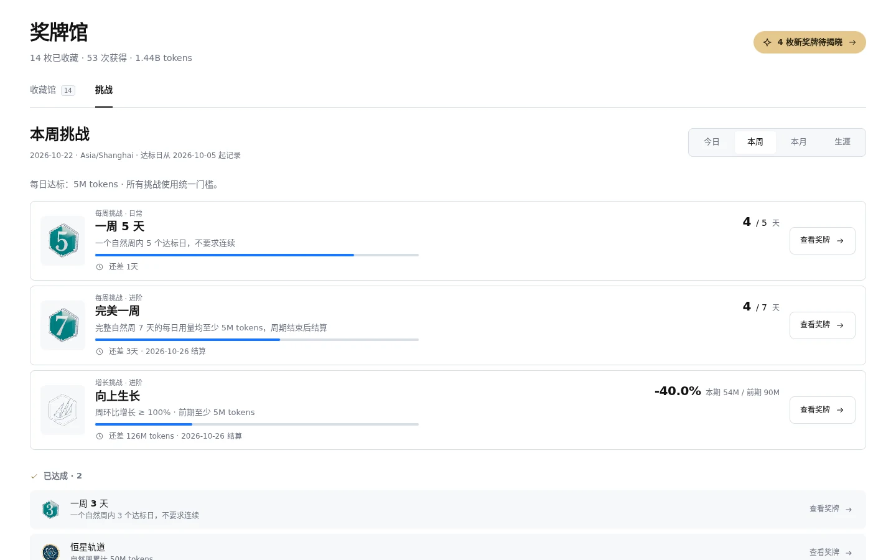
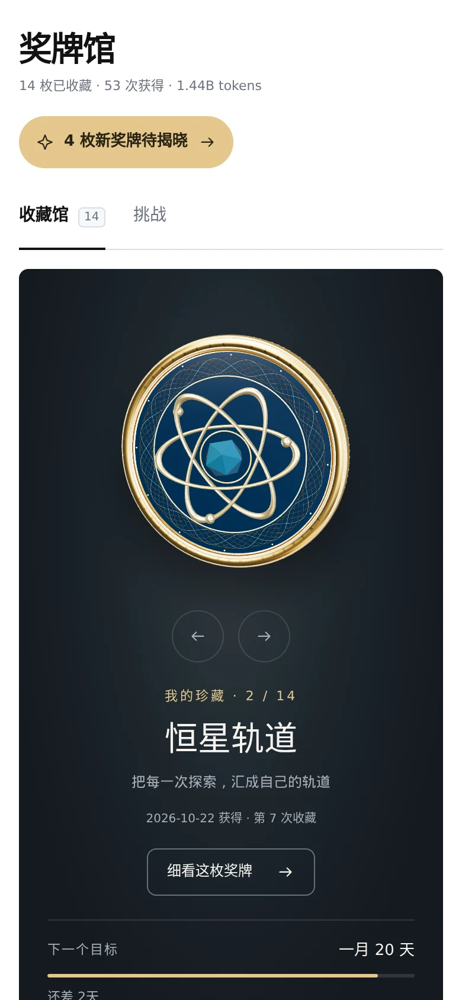
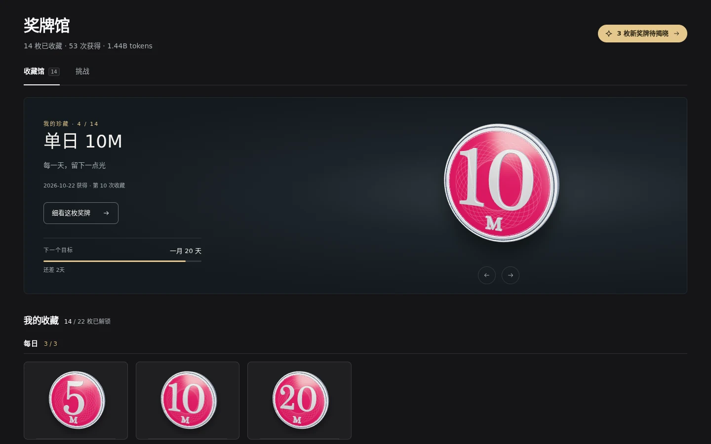

# DSH Medals

DSH Medals 是 DeepSeek Harness Web 的个人奖牌插件。它读取本机 DSH 会话的 token 用量，按固定规则颁发奖牌，并把所有奖牌陈列在「奖牌馆」中。每枚奖牌都是可以旋转查看正反面的 3D 模型，带有金属与珐琅材质。

安装后，侧边栏底部会出现「奖牌馆」入口，点击后奖牌馆在主面板中打开。如果是从某个会话进入的，左下角会出现返回按钮，点击即可回到原会话。



## 功能概览

### 收藏馆

22 枚奖牌分为四组陈列：每日、周与月、达标日、里程与突破。每组标题旁显示已获得数量。已获得的奖牌标注获得次数；未获得的奖牌只显示外形线稿，并附带进度条，其中最接近解锁的两枚会单独标出。

页面顶部的展台按获得时间从新到旧轮流展示所有已获得的奖牌，每 6 秒切换一次。可以拖动旋转展台上的奖牌，也可以用箭头切换。展台左下方的「下一个目标」显示当前最接近解锁的奖牌和剩余差距。

<details>
<summary>完整收藏页</summary>



</details>

### 获得新奖牌

获得新奖牌后，侧边栏的「奖牌馆」入口会显示金色数字徽标。打开奖牌馆时，新奖牌会依次播放获得动画：奖牌从画面深处旋转飞入，正面落定后，背景亮起暖色光晕，一道高光扫过金属表面。多枚新奖牌依次播放，每枚看过后单独记为已读。

奖牌馆已经打开时获得的新奖牌不会打断当前操作，只会在页面右上角显示提示。获得动画可以在揭晓页或任意已获得奖牌的详情中重播。



### 奖牌详情

已获得的奖牌在详情中自动缓慢旋转，可以拖动、轻甩，也可以用方向键旋转，或切换到正面、背面。右侧列出挑战条件、首次获得日期和全部获得记录；点击某条记录，会切换到那一次的奖牌版本，序号和日期随之更新。未获得的奖牌显示挑战条件和当前进度。

已获得的奖牌可以点击「分享」生成一张 4:5 竖版分享图，内容包括奖牌、名称、挑战条件、当前选中记录的获得日期、序号和获得次数，以及截至当天的累计用量。生成后可以直接复制图片，或下载为 PNG 文件。





### 挑战进度

挑战页按今日、本周、本月、生涯四个周期列出进度。尚未完成的挑战排在前面，已完成的挑战收在下方。



### 手机与深色模式

手机上收藏馆每行显示三枚奖牌，详情页全屏显示。页面跟随 DSH 的浅色或深色主题；单独打开页面时，跟随系统设置。

<p>
  
  
</p>

系统开启「减少动态效果」后，获得动画、展台轮播和自动旋转都会关闭，奖牌直接以静止状态显示。浏览器不支持 WebGL 时，已获得的奖牌改用预先渲染的正反面图片。

## 挑战规则

所有用户使用同一套门槛。单日用量达到 5M tokens 记为一个「达标日」。

| 系列 | 档位 | 获得方式 |
| --- | --- | --- |
| 每日 | 单日 5M、10M、20M tokens | 每天每档一次，重复获得累计次数 |
| 每周 | 一周 3、5、7 个达标日 | 每周每档一次 |
| 每月 | 一月 10、20 个达标日，以及整月每天达标 | 每月每档一次 |
| 达标日累计 | 7、30、100、365 天 | 每档一次，不要求连续 |
| 用量累计 | 100M、500M、1B、5B、10B tokens | 每档一次 |
| 周期用量 | 一周 50M、一月 200M tokens | 每期一次 |
| 增长 | 周环比 +100%（上周至少 5M）、月环比 +200%（上月至少 20M） | 周期结束后结算 |

补充说明：

- 达标日从启用插件当天开始记录。首次同步时，启用前的历史用量会用于补发用量累计、周期用量和增长类奖牌；这批奖牌直接记为已读，不播放获得动画。
- 「完美一周」「完美一月」要求完整观察整个自然周期且每天达标，周期结束后才颁发。
- 每周从周一开始，日期按首次安装时的服务端时区计算，这个时区之后不会再变。
- 已获得的奖牌永久保留，即使对应的会话日志被删除也不会撤销。

更细的规则和奖牌造型说明见 [docs/challenges.md](docs/challenges.md)，动画与交互的设计决定见 [docs/reveal-animation.md](docs/reveal-animation.md)，术语见 [docs/glossary.md](docs/glossary.md)，各项设计决定记录在 [docs/adr/](docs/adr/)。

## 统计口径

插件通过 DSH 提供的 `sessionPersistence` 服务读取本机所有可读会话，覆盖全部模型和服务商。统计范围仅限本机，不包括其他设备，也不代表账号的总用量。

计入的用量包括未命中缓存的输入、输出、缓存读取和缓存写入，各部分不按价格加权。推理 token 已包含在输出中，不会重复计算。如果会话报告了精确总量且与明细一致，则以总量为准。重试、最终消息替换以及分叉会话继承的历史内容都会去重。

读取暂时失败时，已有奖牌保持不变，暂停颁发新奖牌。DSH 明确拒绝解析的旧格式会话会被排除，页面上会给出提示。

## 数据存储

插件只保存会话 ID、每日用量汇总和获得记录，不保存任何对话内容，也不发送统计数据或请求外部资源。

记录文件位于 `$DSH_HOME/storages/dsh-medals/ledger.json`；未设置 `DSH_HOME` 时，位于 `~/.dsh/storages/dsh-medals/ledger.json`。写入时使用跨进程独占锁，先写临时文件再原子替换。重装前请备份这个文件，否则收藏会丢失。

记录文件损坏时，插件会停止写入，不会自动覆盖原文件。如果 DSH 非正常退出后残留了 `ledger.json.lock`，请先确认锁文件中记录的进程已经退出，再只删除这个锁文件，不要删除 `ledger.json`。

## 语言

奖牌馆跟随 DSH 的中英文设置，面板打开时切换语言也会立即生效。单独访问页面时，可以用 `?lang=zh` 或 `?lang=en` 指定语言，否则跟随浏览器语言。切换语言不会影响奖牌记录和门槛。

## Debug 预览

Debug 预览没有可见入口：连续点击「奖牌馆」标题 5 次即可开启或关闭，相邻两次点击间隔不能超过 2 秒。它用于检查奖牌外观，可以把全部奖牌切换为「已获得」或「未获得」样式。预览只改变显示，不写入任何记录，退出预览或刷新页面后恢复真实状态。

## 安装与构建

需要 Node.js 22 或更高版本，以及 DSH 0.2.1-rc.2 及以上的 0.2.x 版本。

```sh
npm ci --ignore-scripts
npm run build
npm test

# 从 npm 安装
dsh plugin --profile web add @cassius0924/dsh-medals
# 或安装本地目录
dsh plugin --profile web add /absolute/path/to/dsh-medals
```

开启热更新时，DSH 会自动加载新的构建结果；否则请在当前任务结束后重新加载或重启 DSH。插件的页面和接口都挂在 `/api/dsh-medals/` 下，除同源检查外，还经过 DSH 的 `connection.admit` 鉴权。插件只注册一个侧边栏入口，不修改其他插件。

卸载：

```sh
dsh plugin --profile web remove @cassius0924/dsh-medals
```

卸载后记录文件仍会保留。

## 开发测试

`npm test` 运行单元测试。浏览器测试依赖本地的 Playwright 和 DSH 路径，需要按自己的环境调整：

```sh
node test/gallery.browser.mjs
node test/i18n-layout.browser.mjs
node test/fallback.browser.mjs
node test/debug-preview.browser.mjs
node test/real-history.mjs
DSH_TEST_ORIGIN=https://dsh.cassdev.com node test/live-dsh.browser.mjs
```

部署和验证流程见 [docs/deployment.md](docs/deployment.md)，发布流程见 [RELEASING.md](RELEASING.md)。

## 许可

本项目使用 MIT 许可证。

- Three.js 以 MIT 许可证随附，许可文本见构建产物中的 `lib/THREE-LICENSE`。
- 数字奖牌使用的 Baskervville 字形轮廓遵循 SIL Open Font License，见 `vendor/numerals/LICENSE`。

[GitHub 仓库](https://github.com/Cassius0924/dsh-medals) · [npm 包](https://www.npmjs.com/package/@cassius0924/dsh-medals)
